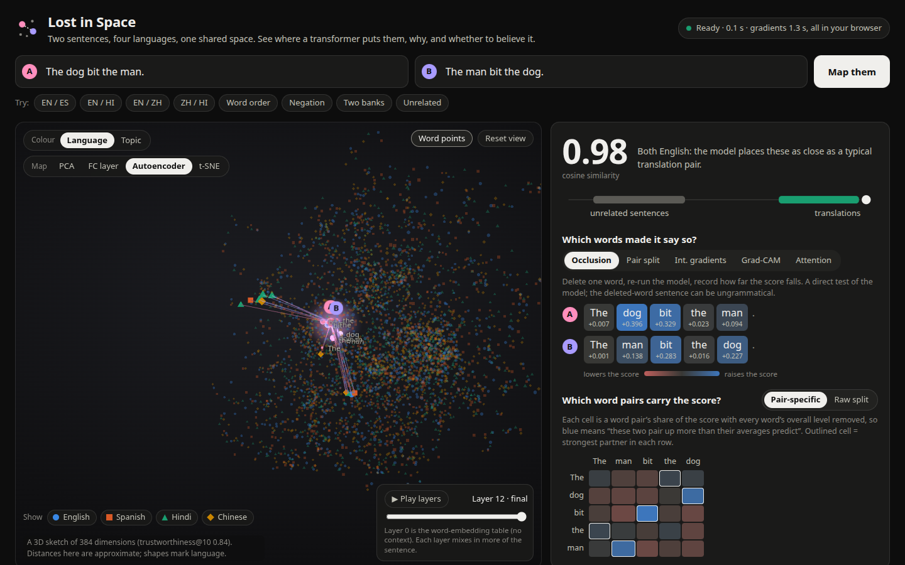

# Lost in Space

AI use: Claude Code (Anthropic) wrote most of the code, scripts and text under Tim Force's direction. Tools, models, roles, dates and what he checked are listed in [`AI_USAGE.md`](AI_USAGE.md).

A multilingual AI model scores "The dog bit the man." and "The man bit the dog." as 0.98 alike, on a scale where 1 is
identical.
Models like it sit under search engines, chatbots that look things up, and translation-matching tools. They return one
number and no reason.

**Lost in Space** is a web page that lets anyone look inside that number. Type two sentences in English, Spanish, Hindi
or Chinese. A 12-layer transformer runs in your browser tab, places both sentences in one shared space, shows which
words drove the score by four explanation methods, and then tests whether each explanation can be believed.
Nothing you type is sent anywhere.

**Live page:** https://timforcejr.github.io/lost_in_space/ (how it was published: [`docs/DEPLOY.md`](docs/DEPLOY.md))
**Poster:** [`poster/LostInSpace_poster_v3.pptx`](poster/LostInSpace_poster_v3.pptx) ([print PDF, 24 × 36 in](poster/LostInSpace_poster_v3.pdf)) · **Results:** [`docs/RESULTS.md`](docs/RESULTS.md) ·
**References:** [`REFERENCES.md`](REFERENCES.md) · **Talk script:** [`docs/TALK.md`](docs/TALK.md)

`docs/`, `poster/`, `AI_USAGE.md` and the other files linked here exist only in the repository; the live site serves only `web/`.

**Builds on / What's new.** Lost in Space builds on the NLP project, a group class project with Ananya Singh and Cherry Lian that asked whether you can visualize how a model understands the feeling of text across languages. New here: Runs in your browser; nothing leaves your device. XAI tools: attribution, maps, layer lens, faithfulness and sanity tests. Visualization to build understanding of how an AI learns meaning.
The NLP project (*Cross-Lingual Embedding Drift in Translation*) ran as a local web page with a Python server, compared
verses and their translations in aligned word spaces and in LaBSE, and found that cosine similarity does not catch real
translation errors (best AUC 0.66 with LaBSE; unpublished class report; not re-tested here). It already had a local 3D view,
checked only on synthetic errors. Its common-space idea, proposed within that group, was inspired by
d'Ascoli et al. (2025) [68], which maps EEG/MEG from 723 people in three languages into a fixed T5 word-embedding space
with one model per dataset; the NLP project tried a shared 3D autoencoder that did not beat PCA. Lost in Space trains no
encoder: it uses the pretrained MiniLM's own 384-d space. Details: [What is new, and what is not](#what-is-new-and-what-is-not)
and [Where each part comes from](#where-each-part-comes-from).



## The question

When a model says two sentences mean the same thing, which words drove that, and which explanation of it deserves belief?

## What the page does

| Part | What you see | How far to trust it (shown next to it) |
|---|---|---|
| **Map** | 4,016 reference sentences (the same 1,004 in each language) squeezed from 384 dimensions to 3 by PCA, a linear layer, an autoencoder or t-SNE. Typed sentences land among them and their true neighbors light up. | A table for every map: Trust@10 (1 = perfect), neighbors kept, translation found, language guessable |
| **Explanations** | Four methods on the same score: occlusion, an exact word-pair split, integrated gradients, attention rollout | A live deletion test on your sentence, and an offline benchmark over 1,224 explanations |
| **Layers** | A slider from layer 0 to 12 that shows where the two sentences come together. The "Model:" dropdown repeats it on a masked-word model, where the languages stay apart (language guessed from the embedding at layer 12: 100% against 40% for the default, chance 25%) | Layer-by-layer averages over 816 held-out sentences |
| **Word order** | Your sentence with its words scrambled, followed through the layers | A benchmark on 816 sentences and on PAWS-X |
| **Break the model** | Swap the model's layers for random ones and see whether each explanation changes | Word-ranking agreement with the trained model, 1 = unchanged |
| **Responsible use** | Who it is for, what a score is not, how it can mislead | |

## What we found

All numbers are generated from logged runs; the full tables are in [`docs/RESULTS.md`](docs/RESULTS.md).
Grad-CAM (last layer) was evaluated during development (deletion gap 0.259) and removed from the page as not adding to the comparison; its numbers remain in `eval/faithfulness.json`.

1. **Explanations disagree, and a test can rank them, on this model.** Removing words in the order each method ranks them, occlusion
   keeps the largest gap between "least important first" and "most important first" (0.45), then integrated gradients
   (0.33) and attention rollout (0.32), between which this benchmark finds no detectable difference (0.015, uncorrected 95% interval −0.001 to 0.030),
   then the exact pair split (0.20). Ranking words by length alone scores 0.13; a random
   ranking scores 0. Intervals resample whole sentences, because each sentence is explained up to six times; they are
   uncorrected for the many comparisons made, so read them as a guide, not as tests.
2. **The ranking holds when words are masked, with smaller gaps.** In an offline test that masks words instead of deleting
   them (not shown on the page; `eval/faithfulness.json`), the order of the methods stays the same and the gaps shrink
   (occlusion 0.319 against 0.448 for deletion).
3. **No method wins everywhere.** After occlusion, integrated gradients is the most faithful for English and Chinese,
   attention rollout for Spanish and Hindi (this model only). Chinese "words" are single tokenizer pieces, so its
   word-length baseline is 0.03 against 0.13 to 0.20 for the other languages: compare each language's gap with its own
   baseline. An offline run on `intfloat/multilingual-e5-small` is in `eval/` (not shown on the page).
4. **Attention rollout fails the sanity check.** With the top 8 of the model's 12 encoder layers re-initialized, its
   word ranking is still 0.97 the same (occlusion: 0.38). Its good deletion score has to be read with that in mind.
   A likely reason, not tested here: rollout reads only attention weights, so the layers that were not damaged may
   dominate its average. The pair split also barely moves (0.49 with all 12 layers re-initialized; occlusion: 0.22).
   (One random draw per depth; the word-embedding table stays trained, so no method falls to 0.)
5. **Scrambling barely moves a sentence's vector, and the last layers hide the language.** Scrambling every word of a sentence
   leaves its vector 0.91 similar to the original (median). On PAWS-X the score separates true paraphrases
   from re-ordered look-alikes with AUC 0.57, barely better than a coin. A language guesser (a linear probe trained on the training split) is right 100% of the time
   through layer 7 and 40% at layer 12 (chance is 25%), so the signal is weakened, not removed. Offline, a linear probe tells natural from scrambled
   with 99% accuracy at layer 5 and 85% at the last layer, but not a single swapped pair (56%), and a probe on the two vectors of a PAWS-X pair
   does no better than the score (0.54); these probe results are in `eval/order.json`, not on the page. A probe shows what can be read from a vector, not what the model uses.
6. **The 3D picture is a sketch.** On the trained maps a new sentence keeps 5% to 8% of its ten true neighbors, so the
   page never reads distances off the picture; neighbors and scores are always computed in 384 dimensions.
7. **Real gradients fit in a browser tab.** The encoder's forward and backward pass, written out by hand and exported
   as one graph (43 MB), matches PyTorch's gradients to 0.2% and runs integrated gradients for both sentences in
   1.3 to 2.7 s on six short test pairs (headless Chrome on a desktop CPU, one thread; expect longer on a laptop and
   for long sentences).
8. **Small rounding, large change in the explanation.** The browser's 8-bit weights move a score by up to 0.012 on
   our six example pairs (up to 0.03 on a second probe set), but for two nearly identical sentences they can change the explanation a lot (on one three-word sentence the word order
   of integrated gradients flipped), because the gradient of a score close to 1 is tiny.

## What is new, and what is not

- **New, as far as we could find** (three to four searches each, logged in [`docs/literature_check.md`](docs/literature_check.md)):
  a tool that attributes a sentence-similarity score entirely in the browser, and a deletion-faithfulness comparison of
  attribution methods for a multilingual similarity model, per language and including Hindi. Not finding something is
  not proof that it does not exist.
- **Engineering, not claimed as new:** the backward pass is written by hand and exported together with the forward
  pass as one ONNX graph, so the stock inference build of onnxruntime-web returns gradients. Tools that export gradient
  graphs exist elsewhere; we did not search that literature.
- **Extended from prior work:** Vasileiou & Eberle [16] ran a perturbation test on similarity attributions in English only;
  we add three more languages, an offline second removal operation (masking) and the randomization sanity check of Adebayo et al. [27].
- **Not new:** the explanation methods themselves [10, 11, 13], and the exact pair split, which is the identity written out by
  Lee et al. [14]. They argue it is a weak explanation. On our deletion test it ranks last of the four methods on the
  page: it beats ranking words by length on this model, but only modestly (by 0.06, interval 0.05 to 0.08; 0.01 when
  words are masked in the offline test).

## What this project adds beyond the NLP project

Lost in Space is an XAI project: it asks how well an explanation of a similarity score matches what the model does. It adds
tools that run in the page, tests that grade them, and measured limits. The tools show how well each explanation matches
the model's behavior, not how the model works inside. Every number below is read from `eval/*.json`.

| Added | What it is | Headline result |
|---|---|---|
| Four attribution methods | Occlusion, exact pair split, integrated gradients, attention rollout | `web/js/xai.js`, `web/js/grad.js` |
| Faithfulness benchmark | Deletion test on the page (an offline masking test and an E5-small run are in `eval/`), 1,224 explanations, four languages | Occlusion first (`eval/faithfulness.json`) |
| Layer re-initialization sanity test | Re-initialize the top layers, compare word scores | Attention rollout stays at 0.97 rank agreement with 8 of 12 layers re-initialized (`eval/sanity.json`) |
| Map fidelity | Trust@10 and translation retrieval, 384-d against 3-d | Trust@10 0.785 (PCA), 0.808 (linear), 0.836 (autoencoder); retrieval 0.995 in 384-d against 0.328 to 0.395 (`eval/map_fidelity.json`) |
| In-browser port | int8 ONNX model and a hand-exported gradient graph, with parity checks against PyTorch | `eval/export_parity.json`, `grad_parity.json`; nothing you type leaves the tab |
| Two-screen mode | "Pop out" moves the whole map block (graphic, legend and all its controls) into its own window and removes it from the main page, so the explanation and cards reflow into the space; closing it docks the block back. The map is a full-width row at the top (fixed there; its "−" folds it), over two equal columns of units (the explanation and each evidence card): drag any unit by its title header into either column, also below the explanation (or focus the header and press the arrow keys), or fold it to its header bar with the small "−" in its corner (single-column widths add small up / down buttons); the untouched default is balanced so both columns end level; the arrangement and the folded set are saved per device in the browser's localStorage (not a cookie, nothing is sent anywhere; "Reset layout" undoes it). While the map is popped out its row disappears and the two columns move up and re-flow | `tests/popout.mjs` |
| Verified literature check | Every citation looked up against a primary record | `docs/literature_check.md` |
| Test suite and audit trail | Scripted tests and an AI usage log | `tests/`, `AI_USAGE.md` |

## Where each part comes from

| Source | Parts |
|---|---|
| **From the NLP project (group class project)** | The autoencoder / linear-layer-to-3D idea, the rule that 3D is layout only, trust@10 and a language guesser as map checks, per-language centering, the reading list [54–65], the four-language set, and one result (AUC 0.66, LaBSE). |
| **Third-party** | The MiniLM models (and E5 for an offline run), SIB-200/FLORES-200, PAWS-X, the explanation methods, transformers.js, three.js. |
| **New in Lost in Space** | The in-browser page and pop-out, the four methods' implementation, the gradient export, the maps and their fidelity numbers, the layer lens and language guesser by layer, the deletion benchmark, the sanity check, the word-order study, responsible use, the poster and the talk. |
| **Not used** | NLP project code, trained models, MUSE, Bible text and its Hindi/Chinese translation work. |

## Who it is for, and why it matters

Built as a visualization and teaching aid: it is meant to help people see how a model encodes information. The model is already
trained; the page turns its hidden numbers into pictures.

People who build or rely on search, retrieval, duplicate detection or translation matching that runs on sentence
embeddings, and students learning how such models work. A similarity score is easy to over-trust: it is a clean number
between 0 and 1, and a tidy explanation makes it more convincing still [66, 67]. This page puts a test next to every
picture so that the reader can see when an explanation does not hold up.

## Run it

```bash
./serve.sh                 # http://127.0.0.1:8137/  (this machine only)
./serve.sh 8137 0.0.0.0    # reachable from other machines on your network
./serve.sh 8137 tailscale  # bound to this machine's Tailscale address only
```

It is a static site: any web server pointed at `web/` works. Nothing is installed and no text leaves the browser.
The first visit downloads the default model (118 MB in two files, plus a 9 MB tokenizer) and, after the first result, the
gradient model (43 MB). The header dropdown "Model:" can switch to the masked-word model, `Multilingual-MiniLM-L12-H384` (about 113 MB in two files, same tokenizer; its gradient graph about 41 MB), downloaded only when you pick it; the page reloads with the chosen model.
Over HTTPS or on `localhost` the browser caches both. Needs a browser with WebAssembly; the 3D view needs WebGL.

## Repository layout

| Path | What |
|---|---|
| `web/` | The whole app: `index.html`, `about.html`, `css/`, `js/`, `data/`, `model/`, `vendor/` |
| `web/about.html`, `web/js/about.js` | Limits, related work, references, credits and AI use, responsible use and how to read the cards (linked from the footer of the main page) |
| `web/js/engine.js` | Loads the model, runs padded batches, queues every inference call |
| `web/js/xai.js` | Occlusion, pair split, attention rollout, deletion test |
| `web/js/grad.js` | Integrated gradients and gradient × input, from the gradient model |
| `web/js/order.js` | The live word-order test |
| `web/js/heads.js`, `view3d.js`, `charts.js`, `tokens.js` | The four maps, the 3D viewer, charts, word grouping |
| `build/export_model.py` | Exports the encoder to ONNX with all hidden states and attention maps, quantizes it, checks parity |
| `build/export_grad.py` | Writes the forward and backward pass as one graph, checks it against autograd, exports it |
| `build/build_cloud.py`, `build_tsne.py` | Embeds SIB-200, fits the maps, measures map fidelity |
| `build/eval_attribution.py` | Faithfulness benchmark (deletion and masking, optional second model, used for the offline E5-small run; it still computes the Grad-CAM rows that remain in `eval/faithfulness.json`) |
| `build/eval_sanity.py` | Model-randomization sanity check |
| `build/eval_order.py` | Word-order experiments; the page uses the scramble benchmark and the PAWS-X score, the probes are offline |
| `build/eval_placement.py` | How well a new sentence's neighbors survive on each map |
| `build/make_results.py` | Generates `docs/RESULTS.md` from `eval/*.json` |
| `build/common.py` | Shared paths, seed, model and SIB-200 loading (downloads go to `.cache/`) |
| `build/rescore_tsne_probe.py` | Re-scores only the t-SNE language probe from the existing t-SNE coordinates (no refit) |
| `build/export_mlm.py`, `build_mlm_data.py`, `build_mlm_tier1.py`, `check_mlm_data.py`, `check_mlm_tier1.py` | The masked-word model: export, its map data, its word-order probe, t-SNE and gradient graph, and their checks. Not runnable from this repository alone (see [Rebuild everything](#rebuild-everything)) |
| `eval/*.json` | The logged runs. Every benchmark number in the documentation and on the poster is read from these; the poster's example pairs come from `poster/fig/*.json`, captured from the running page |
| `eval/history/` | Superseded runs (v0, and the v1 files whose intervals resampled explanations, not sentences), kept for the record; nothing reads them |
| `tests/` | Headless-Chrome page tests: `smoke.mjs` (end to end), `models.mjs` (model dropdown), `jump.mjs` (the page does not jump when the benchmark language or a map language button is toggled), `layout.mjs`, `popout.mjs`, `about.mjs`, `theme.mjs`, `web_fixes.mjs`; parity checks against Python: `check_heads.py`, `check_grad.py`, `grouping_parity.py` / `.mjs`; masked-word model browser parity: `browser_parity_mlm.mjs`, `browser_parity_mlm_ig.py`; its load timing: `load_timing_mlm.mjs` (with the helper `static_server_mlm.mjs`); `poster_check.py` (poster text, needs a poster build first) |
| `poster/` | `build_poster_v3.js` (the 24 × 36 in portrait poster: `LostInSpace_poster_v3.pptx`, print PDF `LostInSpace_poster_v3.pdf`), `make_qr.js` (QR code for the live page), `capture.mjs` (dumps the example pair's numbers from the running app into `fig/`) |
| `docs/` | Results, talk script, deploy steps, literature check |
| `docs/citation_numbers.json` | Maps reference keys to citation numbers 1 to 68 (number 12 is retired); entries 69 to 73 of `REFERENCES.md` were added later and are not in it (all 72 entries are in `web/data/references.json`); kept for reference, no script reads it |

## Rebuild everything

Python 3.12+ (results produced with 3.13.13); exact versions are in `requirements.lock.txt`. Times are for a 64-core CPU machine; no GPU is needed.
Start from the repository root (the block below then changes into `build/`). If `.venv/bin/python` is not executable (a copied or moved venv), delete `.venv` and create it again.

Before you rebuild (none of this is needed to view the page):

- `export_model.py` writes a 470 MB full-precision `web/model/mmini/onnx/model.onnx` (gitignored) and then overwrites the
  tracked 8-bit files `web/model/mmini/onnx/model_quantized.onnx` and `.onnx_data`; `export_grad.py` overwrites the
  tracked `web/model/mgrad/onnx/model.onnx`. An export that is not bit-identical changes what the page loads. It needs
  about 1 GB of free disk and network for the model download; a scratch copy of the repository is the safe place to run it.
- The masked-word model in the dropdown (`build/export_mlm.py`, `build_mlm_data.py`, `build_mlm_tier1.py`,
  `check_mlm_*.py`) cannot be rebuilt from this repository alone: those scripts import code and read results from the
  untracked `experiments/` folder of the alignment-vs-drift study, and their run lines use local Python paths. Their outputs are in
  the repository: `web/model/mlm/`, `web/model/mgrad_mlm/`, `web/data/mlm/` and the logs and checks in `eval/variants/mlm/`.

```bash
python3 -m venv .venv
.venv/bin/pip install --extra-index-url https://download.pytorch.org/whl/cpu -r requirements.lock.txt
cd build
../.venv/bin/python export_model.py       # ~1 min; downloads the model from Hugging Face
../.venv/bin/python export_grad.py        # seconds
../.venv/bin/python build_cloud.py        # ~3 min; downloads SIB-200
../.venv/bin/python build_tsne.py         # ~30 s
../.venv/bin/python eval_placement.py     # seconds
../.venv/bin/python eval_attribution.py   # 10 to 25 min (6 processes x 8 threads)
../.venv/bin/python eval_attribution.py --model intfloat/multilingual-e5-small --prefix "query: " --tag e5 --n 102
../.venv/bin/python eval_sanity.py        # ~10 min
../.venv/bin/python eval_order.py         # ~5 min; downloads PAWS-X (en, es, zh)
../.venv/bin/python make_results.py       # writes docs/RESULTS.md
```

Seeds are fixed (`SEED = 20261115` in `build/common.py`). Held-out test splits are never used to choose a setting.

| Resource | Source | License |
|---|---|---|
| Model (default) | [`sentence-transformers/paraphrase-multilingual-MiniLM-L12-v2`](https://huggingface.co/sentence-transformers/paraphrase-multilingual-MiniLM-L12-v2) | Apache-2.0 |
| Masked-word model (header dropdown; masked words only; built by `build/export_mlm.py`) | [`microsoft/Multilingual-MiniLM-L12-H384`](https://huggingface.co/microsoft/Multilingual-MiniLM-L12-H384), revision `6e8c1ec` | MIT |
| E5-small, used for an offline run in `eval/` (not on the page; not in the dropdown) | [`intfloat/multilingual-e5-small`](https://huggingface.co/intfloat/multilingual-e5-small) | MIT |
| Reference sentences | [SIB-200](https://huggingface.co/datasets/Davlan/sib200) (`eng_Latn`, `spa_Latn`, `hin_Deva`, `zho_Hans`), built on FLORES-200 | CC BY-SA 4.0 |
| Word-order benchmark (offline only) | [PAWS-X](https://huggingface.co/datasets/google-research-datasets/paws-x) (`en`, `es`, `zh`) | free use with attribution |
| Runtime, vendored in `web/vendor/` | transformers.js 3.7.5 with onnxruntime-web; three.js 0.187.0 | Apache-2.0 / MIT; MIT |

### Poster

Node 22 or newer.

```bash
cd poster && npm ci
node make_qr.js          # writes poster/fig/qr_live.png (QR code for the live page)
node build_poster_v3.js  # writes LostInSpace_poster_v3.pptx and, with LibreOffice `soffice` on PATH, the print PDF
```

## Test

Run from the repository root. `npm install` in `tests/` installs the only dependency, `puppeteer-core` 23 (needs Node 18
or newer; the tests were run with Node 22). Run `smoke.mjs` first: `check_heads.py` and `check_grad.py` read the
`tests/out/results.json` it writes. The Python checks use the venv from [Rebuild everything](#rebuild-everything);
`grouping_parity.py` downloads the model and SIB-200 into `.cache/` on first use, so it needs network.

```bash
cd tests && npm install && cd ..
./serve.sh 8137 &
node tests/smoke.mjs http://127.0.0.1:8137/ tests/out          # exits non-zero on any console error, failed or off-site request
node tests/about.mjs http://127.0.0.1:8137/                    # about.html loads, has its sections; the footer links resolve
node tests/jump.mjs http://127.0.0.1:8137/                     # the page does not jump when the benchmark language or a map language button is toggled
.venv/bin/python tests/check_heads.py                          # browser 3D coordinates == Python
.venv/bin/python tests/check_grad.py                           # browser gradients vs PyTorch autograd; writes tests/out/grad_browser_parity.json
# add --record only to refresh the logged eval/grad_browser_parity.json (then re-run build/make_results.py)
.venv/bin/python tests/grouping_parity.py && node tests/grouping_parity.mjs   # browser word grouping == Python
```

Needs Google Chrome (`CHROME=/path/to/chrome` to override). The smoke test also checks that the gradient model's score
matches the main model's, that integrated gradients add up, that a switched-off language never appears in a neighbor
list, and that the page fits a 390-pixel-wide phone. It also checks that the page has four method tabs and no Grad-CAM.

## Design decisions

- **Model.** `paraphrase-multilingual-MiniLM-L12-v2` (12 layers, 384 dimensions, mean pooling) [2, 3]. It is small enough
  for a browser, and mean pooling is what makes the exact word-pair split possible.
- **Explanation target.** The cosine similarity between the two sentence embeddings, with the other sentence held fixed.
- **Two model files.** The main model has 8-bit weights and returns every layer's states and attention maps (118 MB,
  split so that no file exceeds GitHub's 100 MB limit). The gradient model holds only the 12 encoder layers with
  float16-stored weights (43 MB); the 96 MB word-embedding table is not needed for gradients.
- **Gradients without an autograd engine.** The inference build of onnxruntime-web that transformers.js ships has no
  autograd. `build/export_grad.py` writes the
  backward pass of every layer by hand (attention, layer normalization, GELU), checks it against `torch.autograd`
  (relative error 6e-6) and exports forward and backward as one graph. One inference call returns the gradient of the
  score with respect to every layer's states.
- **Integrated gradients.** Straight path through the embedding layer's output, from the sentence with every word
  replaced by padding, 24 midpoint steps; the same definition in the browser and in the benchmark.
- **The 3D position never decides anything.** Neighbors and scores are computed in 384 dimensions. The map is a picture,
  and the page says how lossy it is.
- **t-SNE is a fourth map with different rules.** It is precomputed and has no formula, so a typed sentence is drawn at
  the center of its 8 nearest reference sentences. It keeps neighborhoods far better than the trained maps, but its
  long distances mean nothing [45, 46]. Its fit includes the sentences it is scored on, so its table row is not
  like-for-like with the three trained maps.
- **Language switches are display only.** Every reference sentence exists in all four languages, so a point in a
  language you do not read shows its English (or first switched-on language) version.
- **No build step, no server, no tracking.** Plain ES modules and vendored libraries, so the page can be hosted anywhere
  and inspected by anyone.

## Limitations

- The benchmark covers translation pairs only (mean similarity 0.85); it says nothing about pairs that differ in
  meaning, such as paraphrases with a changed fact or near-duplicates with a negation.
- Two selectable models, both with 8-bit weights in the browser (the default and a masked-word model of the same size). The offline benchmark (612 translation pairs, 1,224 explanations) and the sanity check were measured on the default model only. The map's trust numbers, the deletion curve for your sentences and the layer lens are computed for the loaded model. Integrated gradients on the masked-word model is computed but not benchmarked for faithfulness (its browser values match Python's within 0.0015 per word, `eval/variants/mlm/browser_parity.md`): scores can move by up to 0.03 against full precision, and the gradient
  model's score can differ from the main model's by about 0.01. The page explains the model it runs; explanations of
  near-identical pairs can differ visibly from the full-precision model's (section 4 of `docs/RESULTS.md`).
- Removing a word, by deleting or masking it, gives the model an input it rarely saw in training [26]. The page grades by deletion; an offline masking test
  (`eval/faithfulness.json`) checks that the ranking does not depend on that choice.
- The model was trained to match translations, so it can under-show meaning that does not translate [2].
- Integrated gradients depends on its baseline; only one baseline was tried.
- The pair split reads the last layer, where every word vector already holds context from the
  whole sentence, so it credits contextualized tokens, not input words.
- Attention rollout never looks at the other sentence, and it barely changes when most of the model is replaced by
  noise (section 2 of `docs/RESULTS.md`).
- The offline word-order probe (not on the page) shows that order can be read from a vector, not that the model uses it [39, 40].
- The reference sentences are news-style text in four languages. Nothing was tested on chat, dialect, mixed-language
  text or other languages. PAWS-X has no Hindi.
- The Hindi and Chinese example sentences were written with AI help and have not been checked by a native speaker.
- No user study has been run. We do not know yet whether the page changes how much people trust a score.

## Responsible use

- **A score is not a verdict.** It says how close one model puts two sentences. It does not say they mean the same,
  that a translation is correct, or that a statement is true. The NLP project, the group class project this
  builds on, found that cosine similarity does not detect real translation errors
  (best AUC 0.66 with a different model, LaBSE; unpublished class report; not re-tested here).
- **Do not use it** to check a medical or legal translation, to judge someone's writing (plagiarism, authorship), or to
  settle whether two claims agree.
- **Misuse risk.** An explanation can be shown without its test to make a score look justified. Every explanation on
  the page sits next to a test for that reason; if you reuse a picture from it, keep the test.
- **Dual use.** The word-order test shows that re-ordered or scrambled text keeps a high score. Anyone running a
  similarity-based duplicate or plagiarism filter should know that; it is also a hint for getting past one.
- **Who is affected.** People whose language the model serves worse may get worse search results and less reliable
  explanations. Measured differences are small for retrieval (an English sentence finds its translation 201 times of
  204 in Hindi, 204 of 204 in Spanish and Chinese) and larger for explanations: Chinese has the lowest
  faithfulness for two of the four methods when words are deleted and for all four in the offline masking test (but Chinese
  "words" are single tokenizer pieces, so its word-length baseline is only 0.03 against 0.13 to 0.20 for the other
  languages, and its gaps are not directly comparable), and under
  masking (offline) in Hindi the pair split does no better than ranking words by length (table 1
  in `docs/RESULTS.md` and `eval/faithfulness.json`). Every benchmark pair has English on one side; no pair between
  two of the other languages was tested.
- **Privacy.** Sentences are processed in the browser and are never sent anywhere. They are put in the page address
  (after the `#`) so that a link reproduces the result, so they appear in browser history and in any copied link. The
  language switches are remembered in local storage. The web host sees ordinary file requests, never the text.

## Related work

Sentence-embedding models [1–3] score two texts by the cosine of their pooled vectors; LaBSE [8] and encoders built on
XLM-R [9] are the best-known multilingual alternatives to the one used here. Explaining that score is an active area:
BiLRP [15, 16] and integrated Jacobians [17, 18] attribute it to token pairs, others decompose the embedding itself
or compare token sets [19, 22–24], and a 2025 survey [20] and a 2026 Python toolkit [21] collect the methods; the toolkit tests this page's model against human word alignments in ten
language pairs. We grade explanations by removing words in ranked order [25, 28, 29], repeat with a second removal
operation [26] and run the model-randomization sanity check [27]. Faithfulness across languages has been measured for
classifiers [32, 33]; for similarity models we found a perturbation test in English only [16]. The layer view follows
work on where multilingual models align languages [34–36], on the geometry of contextual vectors [37] and on probing
and concept testing [38–41]; the word-order test follows PAWS [6, 7] and studies showing that language and
vision-language models often ignore order [42–44]. The map follows the Embedding Projector [49] and interactive
tools for inspecting transformers [50–52], with fidelity measured by trustworthiness and continuity [47, 48]. The cross-lingual alignment papers [54–65] come from the reading list of the NLP project, the group class project,
and are the background for the "shared space" idea; d'Ascoli et al. [68] inspired that project's common-space idea. Numbers in brackets refer to [`REFERENCES.md`](REFERENCES.md), where every entry was checked
against a primary record.

## Future work

Each item follows from a result above.

- **No user study was run.** Does seeing the deletion test next to an explanation reduce over-trust in a wrong score
  [66, 67]? A small think-aloud with three to five people would be the first step.
- **Only one model was benchmarked on the page.** Benchmark more models (the page now loads a masked-word model in the dropdown, but only the default one is benchmarked), including ones without mean pooling
  (the pair split does not apply to them), and pairs that do not include English.
- **The pair split did poorly.** Compare it with the pair-level methods from the literature (BiLRP, integrated
  Jacobians) under the same deletion test.
- **Per-language common map (not built).** Future work: a model trained on each language's text, with separate input layers into one shared space, to test whether untranslatable meaning shows up as distance. This page trains nothing into its shared space; it measures how shared that space already is.
- **Attention rollout failed the sanity check.** Test gradient-weighted variants of rollout the same way.
- **8-bit rounding changed explanations.** Measure how often, over many pairs, and try a float16 main model.
- **The sanity check used one random draw.** Repeat it with several seeds and report intervals.
- **Word order.** Rerankers and cross-encoders read both sentences at once; do they separate PAWS-X pairs, and do
  the same explanation methods stay faithful for them?
- Review of the Hindi and Chinese examples by native speakers; WebGPU for faster gradients.

## Licenses and credits

Code: MIT (see [`LICENSE`](LICENSE), which lists what it does not cover). Model: Apache-2.0 (Reimers & Gurevych); masked-word model (header dropdown): MIT, Copyright (c) Microsoft Corporation (notice in [`web/model/README.md`](web/model/README.md)).
Reference sentences: SIB-200, CC BY-SA 4.0 (Adelani et al. 2024), built on FLORES-200. transformers.js / onnxruntime-web:
Apache-2.0 / MIT. three.js: MIT. Lost in Space is Tim Force's individual XAI project. The NLP project was a group
class project with Ananya Singh and Cherry Lian; its report credits each member's part. The common-embedding-space idea came from the BCI paper (d'Ascoli et al., arXiv 2412.17829) that Ananya Singh found. No NLP project code, trained model or data is used here,
including its restricted sources (MUSE dictionaries, Bible verse text); only its ideas, its reading list and one result
(unpublished class report) are carried over. The vendored three.js 0.187.0 file is the same MIT release the NLP project
vendored.
